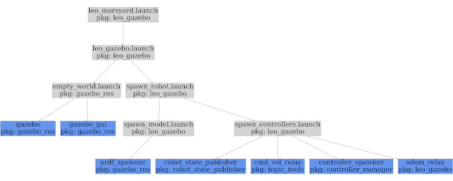

## Overview

This package provides configuration and launch files, as well as,
additional [gazebo](gazebo) models, worlds and plugins that can be used
to simulate [Leo Rover](Robots/Leo Rover).

## Usage

To run Gazebo in an empty worlds and spawn the robot in it, simply type:


```
roslaunch leo_gazebo leo_gazebo.launch
```

 Alternatively, you can use check out the
example **marsyard** world which features a more challenging terrain:


```
roslaunch leo_gazebo leo_marsyard.launch
```


Once you have the simulation running, you can use packages from the
[leo_desktop](https://index.ros.org/p/leo_desktop) bundle to control the
simulated robot (the same way you can control the real one).

For example, start: 

```
roslaunch leo_viz rviz.launch
```

 Enable the Image display to
view the images from simulated camera. Then, type:


```
rosrun leo_teleop key_teleop
```

 To control the robot with a keyboard.

### Spawning multiple robots

Running the simulation with multiple robots in one environment is a
little bit trickier, as we have to guarantee that:

- each robot model in Gazebo has a different name,
- the robots use different ROS topic and services names,
- the robots use different [tf](https://index.ros.org/p/tf) frame names.
  For this purpose, you can use the `model_name` and `robot_ns`
  launch file arguments.

For example, to spawn a second robot when Gazebo is running, type:


```
roslaunch leo_gazebo spawn_robot.launch model_name:=another_leo robot_ns:=leo1
```

 This will spawn `another_leo` model in
Gazebo, start all the nodes and gazebo plugins in the `leo1` namespace
and add `leo1/` prefix to all published tf transformations (e.g.
`base_link` becomes `leo1/base_link`).

Now, to use the newly spawned Leo in ROS, you just have to run the nodes
in the `leo1` namespace and use the prefixed tf frames, for example:


```
ROS_NAMESPACE=leo1 rosrun leo_teleop key_teleop
```

 To use RViz, change the **Fixed Frame** to
`leo1/base_footprint` and set the **TF Prefix** parameter in the
[RobotModel](https://index.ros.org/p/rviz) display to `leo1`.

## Nodes

### odom_relay

A simple node which relays odometry calculated by
[diff_drive_controller](https://index.ros.org/p/diff_drive_controller)
to topics which are used by the
[firmware](https://index.ros.org/p/leo_fw) on the real robot.

#### Subscribed Topics

- `controllers/diff_drive/odom`
  ([nav_msgs/msg/Odometry](https://docs.ros.org/en/rolling/p/nav_msgs/msg/Odometry.html)):
  Odometry computed by the differential drive controller.

#### Published Topics

- `wheel_odom`
  ([geometry_msgs/msg/TwistStamped](https://docs.ros.org/en/rolling/p/geometry_msgs/msg/TwistStamped.html)):
  Current linear and angular velocity estimated from simulated wheel
  positions.

## Launch files



spawn_model.launch:: Spawns the robot model (URDF) into the simulation
environment. spawn_controllers.launch:: Spawns ROS controllers for the
robot model running in the simulation environment. Starts some
additional nodes to simulate ROS API of the real robot.
spawn_robot.launch:: Spawns the complete robot into the simulation
environment. leo_gazebo.launch:: Starts the gazebo simulator with the
empty world and spawns the robot in it. leo_marsyard.launch:: Starts the
gazebo simulator with the `marsyard` world and spawns the robot in it.

## Gazebo plugins

### leo_gazebo_differential_plugin

This plugin simulates the differential mechanism from the double-rocker
suspension used in Leo Rover. It works by applying opposite forces to 2
joints proportional to the difference in position between the joints.

Example usage: 

```
<gazebo>
  <plugin name="rocker_differential" filename="libleo_gazebo_differential_plugin.so">
    <jointA>rocker_L_joint</jointA>
    <jointB>rocker_R_joint</jointB>
    <forceConstant>100.0</forceConstant>
  </plugin>
</gazebo>
```
